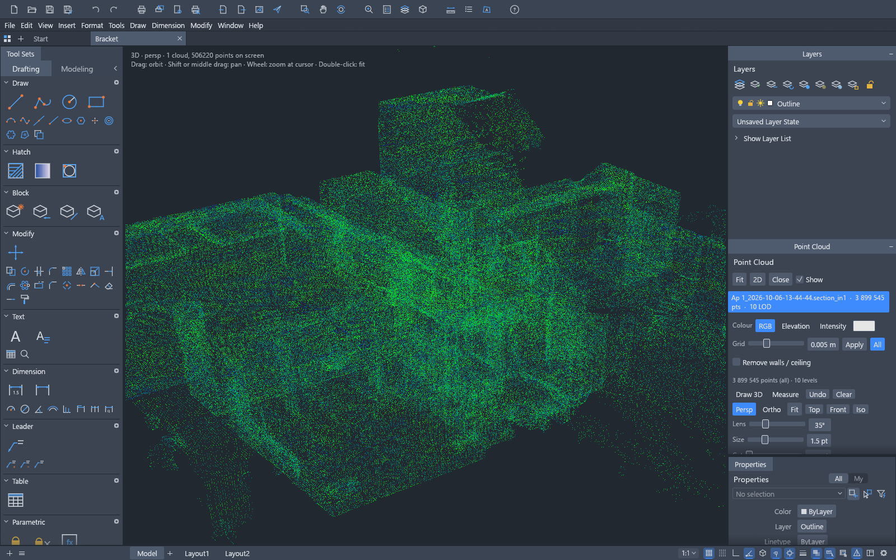

<h1 align="center">RENCAD</h1>

<p align="center">
  <b>Point-cloud CAD: LAS/LAZ scans in a fast, open-source 2D and 3D drafting application, built in pure Rust.</b>
</p>

<p align="center">
  A fast, open-source CAD workflow: the command line, object snaps, layers,
  dimensions, hatches, blocks and DXF drawings you already know — plus a
  <b>point cloud</b> you can open, look at in 3D and draft over.<br>
  <i>A fork of <a href="https://github.com/storytold/cadcraft">CADCraft</a> by AxXe60.</i>
</p>

<p align="center">
  
  
  
  
  
</p>

> [!NOTE]
> **RENCAD is a fork.** It started from [CADCraft](https://github.com/storytold/cadcraft) by the
> ArtCraft team and keeps its licence (MIT OR Apache-2.0), its notices and its credits; the fork
> adds point clouds and 3D drafting on top. It is not affiliated with or endorsed by the ArtCraft
> team, and it does not use the ArtCraft name, wordmark or logos.

<p align="center">
  <a href="#point-clouds">Point clouds</a> ·
  <a href="#screenshots">Screenshots</a> ·
  <a href="#quick-start">Quick start</a> ·
  <a href="#drive-it-from-agents-mcp-and-the-cli">Agents, MCP and the CLI</a> ·
  <a href="#architecture">Architecture</a> ·
  <a href="#roadmap">Roadmap</a> ·
  <a href="#license-and-credits">License and credits</a>
</p>

## Point clouds

RENCAD reads LAS/LAZ scans and puts them where you can work with them: under the 2D drawing, in a
3D view with a real camera, and as the surface you trace over.

| | What it does |
|---|---|
| **Open a scan** | `LASOPEN`, the palette, or `OPEN scan.las`. A Z band (slice) keeps the floor plan of the scan and drops the rest. |
| **Fast, even on huge files** | A decimation pyramid (16 bytes per point) picks the level that matches the screen density: a 3.9-million-point apartment loads in about a second and draws in 2 ms, with one draw call. |
| **Colour modes** | The file's RGB, elevation, intensity as a spectrum, or one colour. The ramps run over the 2%–98% window of the band, so a few outliers can't flatten the contrast. |
| **Crop without re-reading** | Raise the Z to drop the floor, lower it to drop the ceiling, pull X and Y in to take the walls away. |
| **The ground under the cloud** | **Find ground** separates the floor from the furniture with a morphological filter that follows a slope; **Ground only** then draws the floor plan and nothing else. |
| **Where the scan is** | The coordinate system the file names (EPSG code and WKT) is read, shown in the palette and written next to an exported drawing as a `.prj` file. |
| **The site frame** | A registered survey sits 500 km from the drawing's origin: `LASORIGIN` ties the drawing's (0, 0, 0) to a world point, and `LASCRS` declares the system for the files that name none. |
| **Seeing through the cloud** | **Opacity** makes the cloud transparent and the 3D view thins its points, so a wall seen edge-on stops hiding the drawing under it. |
| **Huge surveys** | A 53-million-point, 1.8 GB scan opens without ever holding the file in memory: the points are binned while the file streams. |
| **3D view** | An orbit camera with a 35° lens or a true orthographic projection, zoom anchored at the cursor, Top/Front/Iso views, and only the points on screen are uploaded. |
| **Clarity without a depth buffer** | A **front wall cut** drops the points between the camera and the target, so you can look into a room; a **depth cue** fades the far ones into the background and shrinks them, so the near geometry stands out. |
| **3D drafting** | Click to place vertices that snap to the cloud, hold a plane with the **Z lock**, follow one axis with **Shift**, close the polyline with **C**, and export DXF `LINE`s with their Z — one layer per stroke. |
| **Smart snapping** | The snap keeps only the **front layer** under the cursor, so it never snaps through a wall; `Exact` takes the point itself, `Smooth` (the default) averages the 2-5 mm scan noise away. |
| **Measure in 3D** | `3DMEASURE` returns the length, the run in plan, the rise and the slope; the measure tool does it with two clicks and shows the numbers live while you draw. |

Everything is a command, so the same work is available from the command line, the CLI, the JSON
control channel and MCP: `LASOPEN`, `LASCOLOR`, `LASDECIMATE`, `LASCLIP`, `LASFRAME`, `3DLINE`,
`3DEXPORT`, `3DSNAP`, `3DMEASURE`. The fork's own overview is in [RENCAD.md](RENCAD.md) (Romanian
and short) and the detailed one in [docs/pointcloud.md](docs/pointcloud.md).

## Screenshots

<table>
  <tr>
    <td width="50%"></td>
    <td width="50%"></td>
  </tr>
  <tr>
    <td><sub><b>Point cloud, 3D</b>: a real scan (Ap 1, Bucharest) in the 3D view, with the depth cue, a measurement and the Point Cloud palette.</sub></td>
    <td><sub><b>2D drawing</b> (<a href="examples/apartment.dxf">examples/apartment.dxf</a>): walls with pick-point hatching, TrueType MTEXT room labels, a TABLE, a multileader and architectural dimensions — built entirely from commands.</sub></td>
  </tr>
</table>

## What works today

The drafting application is in early, fast development. Honest status (see [ROADMAP.md](ROADMAP.md)
for parity numbers):

| Area | Status |
|---|---|
| Drawing area | Model space with adaptive grid, axes, pan/zoom (wheel, middle-drag, pinch), crosshair cursor with pickbox, UCS icon, ViewCube, viewport label |
| Command line | Prompts with keywords, history, AutoComplete, aliases, `@dx,dy`, `@d<a`, `#x,y`, direct distance entry, Enter/space/right-click to repeat, transparent commands, `.scr`-style scripts |
| Draw | LINE, PLINE (arcs, widths), CIRCLE (center/radius/diameter, 2P, 3P), ARC, RECTANG (fillet/chamfer), POLYGON, ELLIPSE (+arcs), SPLINE, POINT, XLINE, RAY, DONUT, TEXT, MTEXT |
| Modify | ERASE, MOVE, COPY, ROTATE, SCALE, MIRROR, STRETCH, OFFSET, TRIM, EXTEND, FILLET, CHAMFER, BREAK, JOIN, EXPLODE, rectangular/polar ARRAY, draw order, OVERKILL |
| Precision | Object snaps (endpoint, midpoint, center, geometric center, node, quadrant, intersection, insertion, perpendicular, tangent, nearest; deferred tangent/perpendicular for the first point of a line, e.g. belt lines tangent to two circles), polar tracking, ortho, grid snap |
| Layers & properties | Layers palette and Layer Properties Manager (on/off, freeze, lock, plot, colour, linetype), layer tools (isolate, freeze, off, lock, match, previous), Properties palette with per-object editing, linetypes, lineweights, colour index and true colour |
| Annotation | All DIM* commands with full DIMSTYLE variables, overrides and every arrowhead, associative dimensions that follow geometry, MLEADER, TABLE, TrueType fonts (`.ttf`, `.otf`, `.ttc` collections), MTEXT formatting codes (fonts, heights, colours, stacked fractions), our own single-stroke drafting font |
| Hatch & blocks | Pick-point hatch boundaries with islands, pattern, solid and gradient fills from our own pattern library, BLOCK/INSERT, attributes and nested blocks |
| Files | DXF read (R12–2018, ASCII and binary) and write (R2000), including dimension styles, associativity, tables and constraints; DWG read (via the acadrust library) and write (R2000); PDF plotting, SVG and PNG export. Entities the app doesn't model yet are not kept on save: see [file-format parity](docs/file-format-parity.md) |
| Layouts & plotting | Paper-space layouts, viewports (scale, lock, per-viewport layer freeze), MSPACE/PSPACE through viewports, page setups, PLOT and EXPORTPDF |
| Parametric | Geometric and dimensional constraints, AUTOCONSTRAIN, PARAMETERS with expressions, conflict detection; constraints re-solve after every edit |
| Grips | Hot grips with Space to cycle Stretch, Move, Rotate, Scale and Mirror |
| **Point clouds (fork)** | LAS/LAZ read, Z band, decimation pyramid, colour modes, crop, 2D overlay, 3D view with perspective/ortho, front wall cut, depth cue, 3D drafting with smart snapping and constraints, per-stroke layers, DXF export, 3D measuring. See [docs/pointcloud.md](docs/pointcloud.md) |
| Interface languages | English, Ukrainian (Українська), Brazilian Portuguese (Português (Brasil)), German (Deutsch), Spanish (Español), Czech (Čeština), Russian (Русский), French (Français), Simplified Chinese (简体中文, with an installed CJK font), Italian (Italiano), Korean (한국어, with an installed Hangul font), Swedish (Svenska), Arabic (العربية, with an installed Arabic font), Hungarian (Magyar) and Turkish (Türkçe), live switching and a remembered Auto/system-language choice; [details](docs/localization.md) |
| Automation | MCP server, JSON control channel, `cadcraft-cli` (info, convert, run, commands, mcp) |

## Quick start

Desktop and web UI builds require Rust 1.95 or later. The core workspace's declared minimum
remains Rust 1.90.

```sh
git clone https://github.com/AxXe60/REN-CAD
cd REN-CAD
cargo run --release -p cadcraft -- --sample       # opens the sample drawing
```

Then try typing at the command line:

```text
line 0,0 @10,0 @0,5 c          a closed triangle
circle 5,2 1                    a circle
offset 0.25                     then pick the circle and a side
zoom e                          zoom to extents
```

And open a scan (the palette's **Point Cloud** section, or):

```text
lasopen {"path":"D:/LIdar/scan.las"}
```

The web build: `cd apps/cadcraft-web && trunk serve` (needs [trunk](https://trunkrs.dev)).

### Fonts

The app has no fonts in its repository; it uses the TrueType/OpenType fonts installed on your
system. Builds made with the optional [craft-fonts](https://github.com/storytold/craft-fonts)
input (`CRAFT_FONTS_DIR=<absolute path to a checkout> cargo build --release`) also embed its
fonts: BIZ UDPGothic, BIZ UDMincho and Shippori Mincho (Japanese) and Noto Sans Arabic (the web
build, which has no system fonts, only BIZ UDPGothic Regular and Noto Sans Arabic). A text style
can use them by family name, and they draw characters a text's font lacks when no installed
wide-coverage CJK font has them. Without `CRAFT_FONTS_DIR` nothing is embedded. SHX
fonts (including big fonts such as `chineset.shx`) aren't read yet: text in an SHX style is drawn
with our own stroke font, and any character a text's font lacks (CJK, for example) is drawn from
an installed font that has it, preferring wide-coverage fonts such as Noto Sans CJK, Source Han
Sans, WenQuanYi, PingFang or Microsoft JhengHei. Two settings, set with `SETVAR` or (for every
run) an environment variable, steer this:

| Variable | Environment | Meaning |
|---|---|---|
| `FONTALT` | `CADCRAFT_FONTALT` | Font used instead of a text style font that can't be found (an SHX file, a missing TTF), by file or family name, e.g. `Noto Sans CJK TC`. Empty (default) = our stroke font. |
| `FONTFALLBACK` | `CADCRAFT_FONTFALLBACK` | Fonts tried first for characters a text's font lacks, comma-separated, e.g. `Noto Sans CJK TC, msjh.ttc`. |

`.` clears either one.

**Your own fonts.** Any `.ttf`, `.otf` or `.ttc` font works: install it in the system font folder
(Windows `C:\Windows\Fonts` or per-user fonts, macOS `/Library/Fonts` or `~/Library/Fonts`,
Linux and the BSDs `/usr/share/fonts`, `/usr/local/share/fonts`, `~/.local/share/fonts` or
`~/.fonts`) and name it in a text style (`STYLE`, or `style {"name":"FA","font":"Vazirmatn"}`)
by file name (`Vazirmatn-Regular.ttf`) or family name (`Vazirmatn`), or inline in MTEXT with
`\fVazirmatn;`. Restart the app after installing a font: the font folders are scanned once.

**Right-to-left text (Persian, Arabic, Urdu, Hebrew).** TEXT and MTEXT lines are laid out with the
Unicode Bidirectional Algorithm (the paragraph direction comes from its first letter, so numbers
and Latin words inside Persian text keep their own order), and Arabic-script text is shaped with
OpenType (contextual letter forms, lam-alef and other ligatures, ZWNJ / ZWJ, mark positioning).
Justification (left, centre, right, MTEXT attachment and wrapping) still refers to the text's box.
Our stroke font has no Arabic letters, so Persian in a stroke-font style is drawn from an
installed font that has them: Vazirmatn, Noto Naskh Arabic, Noto Sans Arabic, Segoe UI, Tahoma,
Arial and DejaVu Sans are looked for first. To choose one, install a free Persian font such as
[Vazirmatn](https://github.com/rastikerdar/vazirmatn) (SIL Open Font License) and either use it in
the text style or set `FONTFALLBACK` (`CADCRAFT_FONTFALLBACK="Vazirmatn"`).

### Logs

The desktop app writes its `log` records to standard error and to `logs/cadcraft.log` in the
settings directory (Linux and the BSDs `~/.config/cadcraft/logs/`, or
`$XDG_CONFIG_HOME/cadcraft/logs/`; macOS `~/Library/Application Support/CADCraft/logs/`; Windows
`%APPDATA%\CADCraft\logs\`; or under `CADCRAFT_CONFIG_DIR`). A start from a desktop menu or the
Dock has no terminal, so this file is what to attach to a bug report. Each launch moves the
previous log to `cadcraft.1.log` (and that one to `cadcraft.2.log`), so the log of a run that
crashed survives the next start. The file stops growing at 16 MiB. `--version` writes no file.

| Variable | Effect |
|---|---|
| `CADCRAFT_CONFIG_DIR` | Use this directory instead of the platform settings directory (the log goes to its `logs/`) |
| `RUST_LOG` | Log levels for standard error and the log file. Default: `info` for the app's own crates, `warn` for everything else. env_logger-style directives replace that, e.g. `RUST_LOG=debug`, `RUST_LOG=warn,cadcraft_io=trace` or `RUST_LOG=info,wgpu_core=warn`; a directive ending in `*` covers every target starting with it (`cadcraft*=debug`). |

The logger is `apps/cadcraft/src/logging.rs`; the web build logs to the browser console instead.

## Drive it from agents, MCP and the CLI

```sh
# MCP server on stdio, headless:
cadcraft-cli mcp
# …or bridged to the running app (start it with --control 7979):
cadcraft-cli mcp --connect 127.0.0.1:7979

# One-shot headless runs:
cadcraft-cli run --sample --script 'CIRCLE 22,3 1\n' --save out.dxf --export out.png
cadcraft-cli info drawing.dxf
cadcraft-cli convert drawing.dxf drawing.svg

# Frame part of the drawing (model space, drawing units, lower-left corner first):
cadcraft-cli convert drawing.dwg detail.png --window 0,0,20000,15000
cadcraft-cli run drawing.dwg --cmd 'zoom {"mode":"window","p1":[0,0],"p2":[20000,15000]}' --export detail.png
cadcraft-cli run drawing.dwg --cmd 'select {"window":[[0,0],[20000,15000]]}' --cmd 'zoom {"mode":"object"}' --export sel.png
```

How image exports (PNG 2400×1600, SVG, PDF) are framed: `convert` fits the model-space extents.
`run --export` shows the current view when the script or commands changed it (`zoom`, `pan`,
`view.set`, …) and otherwise fits the extents too. `--window x0,y0,x1,y1` shows exactly that
rectangle, centred and scaled without distortion; `--view extents` or `--view current` forces
either framing. To frame a selection set, `zoom {"mode":"object"}` after selecting.

MCP tools include `command_line` (type at the prompt), `execute` (any command with JSON),
`inspect_drawing`, `query_entities`, `render` (returns a PNG) and, when connected to the app,
`screenshot` and `ui_click`. The desktop app's JSON control channel is documented in
[docs/control-protocol.md](docs/control-protocol.md); the point cloud view is driven with
`engine.execute` and the `ui.view3d` command (see
[docs/control-protocol.md](docs/control-protocol.md#drive-it-from-agents-mcp-and-the-cli)).

To run LISP routines, scripts and alias files, or to drive the app from your own programs, see
[docs/customization.md](docs/customization.md).

## Architecture

```text
geom ─┐                       f64 geometry: arcs, bulges, splines, intersections, offsets
dxf   │  (standalone)         DXF tag reader/writer
color ┤                       colour index, true colour
doc   ┤                       drawing database, copy-on-write entity store (cheap undo)
fonts ┤ render               stroke font + TEXT/MTEXT layout │ display lists, linetypes, hatches, dims, CPU raster
io    ┤                       DXF mapping, SVG/PNG export
pointcloud ┤ (fork)            LAS/LAZ reading, the decimation pyramid, the colour ramps, the 3D sketch
engine┤                       sessions, commands, command line + prompts, snaps, selection, undo
ui-egui · mcp                 the swappable egui front end · MCP server
apps: cadcraft · cadcraft-cli · cadcraft-web
```

Nothing below `ui-egui` knows about egui, so the front end can be replaced. `cargo xtask ci`
checks formatting, clippy, tests, asset attribution, the crate layering and the wasm build.

The fork keeps its own crates: `cadcraft-pointcloud` reads the scans and holds the drawing rules
(snapping, the 3D sketch, the measurements) as pure functions, and the engine keeps the clouds
and the 3D strokes beside the drawing instead of inside it — a cloud is never a drawing entity, so
snaps, grips, undo and save keep seeing only what you drew.

## Accessibility

### System cursor

Over the drawing area the app hides the system cursor and draws its own crosshair. Tools that
follow the system cursor (Windows Magnifier set to follow or centre the mouse pointer, other
screen magnifiers, screen recorders, remote desktops) lose track of it there. Turn on
**View ▸ Accessibility ▸ Show System Cursor** to keep a small system crosshair visible at the
centre of the drawn one, or start the app with the environment variable
`CADCRAFT_SYSTEM_CURSOR=1` (on Windows, set it once with `setx CADCRAFT_SYSTEM_CURSOR 1` and
start it again). Agents can switch it with the control channel: `ui.set {"systemCursor": true}`.

### Animation effects

The app follows the operating system's animation setting. When the system is set to show no
animations, dialogs, menus and tooltips appear at once instead of fading in, collapsing sections
and scroll bars change at once, and the mouse wheel scrolls lists a whole step at a time instead of
gliding. Zooming the drawing with the wheel always moves a whole step; with Ctrl held (a touchpad
pinch, on Windows) it glides to the new zoom only while animation effects show.

| System | Where the setting is |
|---|---|
| Windows | Settings ▸ Accessibility ▸ Visual effects ▸ Animation effects |
| macOS | System Settings ▸ Accessibility ▸ Reduce motion |
| Linux, BSD | the desktop's reduced-motion (or animations) setting, read through the XDG Desktop Portal |
| Web | the browser's `prefers-reduced-motion` |

A change to the system setting is picked up while the app runs, within a few seconds. To choose
for this app alone, use **View ▸ Accessibility ▸ Animation Effects**: **Use System Setting** (the
default), **On** or **Off**. Options ▸ Display has the same choice. Agents can set it with the
control channel: `ui.set {"animations": "off"}` (`"system"`, `"on"` or `"off"`), and `ui.inspect`
reports whether animations show (`animations`).

Drafting feedback is not an animation effect and stays as it is: rubber bands and previews, snap
markers, the pause that acquires an object snap tracking point, the text cursor's blink, the
spinner shown while a drawing opens, and pan and zoom, which follow the pointer and the wheel
directly.

## Roadmap

See [ROADMAP.md](ROADMAP.md) for the stage, measured parity and the estimate of remaining work,
[docs/gaps.md](docs/gaps.md) for everything still missing, and [RENCAD.md](RENCAD.md) for what the
fork has added and what it plans next.

## Downloads

The fork has no release of its own yet: build it from source with the Quick start above, or take
the upstream's published builds for the 2D/3D drafting core
([latest release](https://github.com/storytold/cadcraft/releases/latest)). The point cloud
features are only in this repository.

## License and credits

This fork is dual-licensed under [MIT](LICENSE-MIT) or [Apache-2.0](LICENSE-APACHE), at your
option, like the upstream it is built on. Copyright (c) 2026 ArtCraft Team and the CADCraft
contributors; the fork's own work is by the RENCAD contributors. Required notices are in
[NOTICE](NOTICE).

Bundled fonts, icons, images and other assets keep their own open licenses; each one is listed
with its author, source and license in [ATTRIBUTION.md](ATTRIBUTION.md).

The app's icons, its single-stroke drafting font, its hatch patterns and its linetypes are all
original work, drawn or defined in code. The sample drawings are generated in code too.

The upstream's ArtCraft name, wordmark and logos are trademarks of the ArtCraft Team and are not
covered by that license. The upstream asks every fork and modified version to remove them, and
this repository does: RENCAD is the fork's own name.
